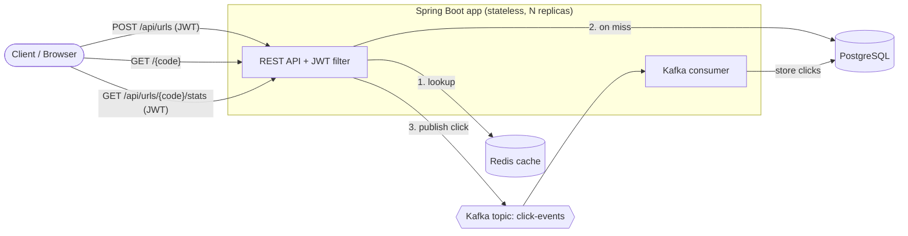

# Distributed URL Shortener & Analytics Platform

A scalable URL shortening service with secure authentication, Redis caching, and asynchronous click analytics built on Kafka. It runs locally with Docker Compose and deploys to Kubernetes as multiple stateless replicas.


## Features

- **Shorten URLs** with collision-free Base62 codes derived from database IDs
- **Fast redirects** using Redis cache-aside with expiry-aware TTLs
- **JWT authentication** with Spring Security (stateless, BCrypt password hashing)
- **Link expiry**: links can expire at a chosen time and are never served from cache past that time
- **Asynchronous analytics**: each redirect publishes a click event to Kafka, and a consumer stores it, so tracking never slows a redirect
- **Per-link stats API** (total clicks, clicks per day), restricted to the link's owner
- **Schema migrations** with Flyway
- **Tested** with unit tests (JUnit, Mockito) and integration tests against real PostgreSQL, Redis and Kafka (Testcontainers)
- **Containerized** with a multi-stage Docker build and **deployable to Kubernetes** (3 replicas, health probes, autoscaling)

## Architecture



**Request flows**

1. **Create:** the client sends `POST /api/urls` with a JWT. The app stores the URL in PostgreSQL, encodes the row ID in Base62, and returns the short link.
2. **Redirect (hot path):** the app checks Redis first. On a miss it reads PostgreSQL and fills Redis. It replies `302` and publishes a click event to Kafka without waiting for analytics.
3. **Analytics (cold path):** a Kafka consumer writes click events to PostgreSQL, and the stats endpoint aggregates them.

## Tech stack

| Technology | Purpose |
|---|---|
| Java 21, Spring Boot 3.5 | Application framework |
| Spring Security + JWT (jjwt) | Authentication and authorization |
| PostgreSQL 16 + Flyway | Source of truth and schema migrations |
| Redis 7 | Cache for `code -> URL` lookups |
| Apache Kafka (KRaft) | Asynchronous click event stream |
| Docker, Docker Compose | Local infrastructure and packaging |
| Kubernetes (Minikube) | Running multiple replicas with probes and autoscaling |
| JUnit 5, Mockito, Testcontainers, Awaitility | Testing |

## Design decisions

| Decision | Reasoning |
|---|---|
| Base62 of the database ID | No collisions by construction, no retry logic. Codes are sequential, so a shuffling step is a planned improvement if guessability matters |
| Cache-aside with TTL | Reads dominate writes. TTL bounds staleness and memory use |
| `302` instead of `301` | Browsers cache `301` permanently, which would hide repeat clicks from analytics |
| Kafka for click tracking | Decouples redirect latency from analytics storage. If analytics is down, redirects keep working |
| Message key = short code | All clicks for one link land in one partition and stay ordered |
| Stateless JWT | Any replica can verify a request, so horizontal scaling needs no shared sessions |
| Flyway + `ddl-auto: validate` | Schema changes are reviewed SQL, never silently generated |

## Getting started

### Prerequisites

- JDK 21
- Docker with the Compose plugin (and your user in the `docker` group)
- `curl`
- Optional, for Kubernetes: `kubectl` and `minikube`

On Linux Mint / Ubuntu:

```bash
sudo apt install -y openjdk-21-jdk docker.io docker-compose-v2
sudo usermod -aG docker $USER   # log out and back in afterwards
```

### Run locally (app on your machine, infrastructure in Docker)

```bash
git clone https://github.com/<your-username>/Distributed-URL-Shortener-and-Analytics-Platform.git
cd Distributed-URL-Shortener-and-Analytics-Platform/shortener

docker compose up -d postgres redis kafka
./mvnw spring-boot:run
```

The app starts on `http://localhost:8080`. Flyway creates the database tables on first start.

### Run everything in Docker

```bash
docker compose --profile app up --build
```

### Stop

```bash
docker compose stop      # keep containers and data
docker compose down      # remove containers, KEEP the database volume
# Avoid "down -v": it deletes the database volume
```

## Configuration

Defaults live in `src/main/resources/application.yml`. Any value can be overridden with environment variables (this is how Docker and Kubernetes configure the app).

| Variable | Default | Description |
|---|---|---|
| `SPRING_DATASOURCE_URL` | `jdbc:postgresql://localhost:5432/shortener` | PostgreSQL connection |
| `SPRING_DATA_REDIS_HOST` | `localhost` | Redis host |
| `SPRING_KAFKA_BOOTSTRAP_SERVERS` | `localhost:9092` | Kafka brokers |
| `JWT_SECRET` | dev-only value | HMAC signing key, at least 32 characters. **Always set your own outside development** |
| `APP_BASE_URL` | `http://localhost:8080` | Base used when building short links |

## API

| Method | Path | Auth | Description |
|---|---|---|---|
| `POST` | `/api/auth/register` | No | Create an account |
| `POST` | `/api/auth/login` | No | Returns a JWT |
| `POST` | `/api/urls` | Bearer token | Create a short URL (optional `expiresAt`) |
| `GET` | `/{code}` | No | Redirect (`302`) to the original URL |
| `GET` | `/api/urls/{code}/stats` | Bearer token (owner only) | Total clicks and clicks per day |
| `GET` | `/actuator/health` | No | Health check |

### Example session

```bash
# 1. Register and log in
curl -X POST localhost:8080/api/auth/register -H 'Content-Type: application/json' \
  -d '{"email":"me@test.com","password":"password123"}'

TOKEN=$(curl -s -X POST localhost:8080/api/auth/login -H 'Content-Type: application/json' \
  -d '{"email":"me@test.com","password":"password123"}' \
  | python3 -c 'import sys,json; print(json.load(sys.stdin)["token"])')

# 2. Create a short link
curl -X POST localhost:8080/api/urls \
  -H "Authorization: Bearer $TOKEN" -H 'Content-Type: application/json' \
  -d '{"url":"https://example.com/some/very/long/path"}'
# -> {"code":"6LAzf","shortUrl":"http://localhost:8080/6LAzf","originalUrl":"https://example.com/some/very/long/path"}

# 3. Follow it (expect HTTP 302 and a Location header)
curl -i localhost:8080/<code>

# 4. Check analytics (clicks appear a moment later, since processing is asynchronous)
curl -H "Authorization: Bearer $TOKEN" localhost:8080/api/urls/<code>/stats
```

### Error behavior

| Situation | Response |
|---|---|
| Missing or invalid token on a protected endpoint | `401` |
| Reading another user's stats | `403` |
| Non-http(s) or malformed URL (for example `javascript:`) | `400` |
| Unknown or expired code | `404` |

## Testing

```bash
./mvnw test
```

- **Unit tests** (`Base62Test`, `UrlServiceTest`): fast, no Docker. They cover encoding, cache hit/miss behavior, expiry, and URL validation.
- **Integration tests** (`UrlFlowTest`): start real PostgreSQL, Redis and Kafka containers with Testcontainers and exercise the full flow (register, login, create, redirect, click count), plus the `401`, `403`, `400` and `404` cases. **Docker must be running.**

## Kubernetes (Minikube)

```bash
minikube start --driver=docker
eval $(minikube docker-env)           # build images inside Minikube's Docker
docker build -t shortener:1.0 .

kubectl apply -f k8s/infra.yaml       # PostgreSQL, Redis, Kafka (development setup)
kubectl apply -f k8s/app.yaml         # app: 3 replicas, probes, ConfigMap, Secret, HPA

kubectl get pods -w
kubectl port-forward svc/shortener 8080:80
```

The app is then reachable at `http://localhost:8080`. The Deployment runs 3 stateless replicas behind a Service, uses readiness and liveness probes on the Actuator health endpoints, and scales between 3 and 8 pods based on CPU (enable `minikube addons enable metrics-server` for the autoscaler).

> **Note:** `k8s/infra.yaml` is a development setup. PostgreSQL and Kafka run as single replicas without persistent volumes. For production use managed services or operators (for example Strimzi for Kafka) and set a real `JWT_SECRET` in a Kubernetes Secret.

## Project structure

```
shortener/
├── src/main/java/com/example/shortener/
│   ├── url/          # shortening, Base62, redirect, Redis caching
│   ├── auth/         # users, JWT service and filter, Spring Security config
│   ├── analytics/    # Kafka producer/consumer, click events, stats API
│   └── common/       # shared exceptions and error handling
├── src/main/resources/
│   ├── application.yml
│   └── db/migration/ # Flyway SQL migrations
├── src/test/java/    # unit and Testcontainers integration tests
├── k8s/              # Kubernetes manifests
├── docker-compose.yml
├── Dockerfile
└── pom.xml
```

## Roadmap

Planned improvements, roughly in priority order:

- [ ] Redis-based rate limiting on login and link creation
- [ ] Dead-letter topic and idempotent click consumer
- [ ] Prometheus and Grafana dashboards (cache hit ratio, redirect latency, consumer lag)
- [ ] GitHub Actions CI pipeline
- [ ] Custom aliases, link disabling and editing
- [ ] Richer analytics (device, browser, country, referrer)
- [ ] Refresh tokens and role-based access
- [ ] Helm chart, Ingress with TLS
- [ ] Load-test results (k6)

## License

Add a license (for example MIT) before publishing, or remove this section.
